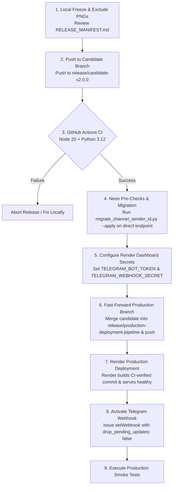

# KisanMitra V2 — Release Candidate Manifest & Deployment Gating Plan

**Date:** November 24, 2026
**Auditor:** Principal Software Architect, Release Manager & DevOps Lead
**Repository:** `/home/chandu/kisanmitra`
**Target Release Branch:** `release/production-deployment-pipeline`
**Current Local HEAD:** `b37e63cf8042d3efee95e881eb9ee154d54c4411`
**Remote Upstream HEAD:** `f43974a20b8f8158d2bd64eb47c169d8b6f319bc` (9 commits behind local HEAD)

---

## 1. Complete File-by-File Inventory & Release Classification

Every modified tracked file and untracked file in the working tree is audited below. **No file has been staged, deleted, or altered.**

### A. Tracked Modified Files (33 Files) — Proposed for Release Inclusion

| File Path | Classification | Release Recommendation | Justification |
|---|---|---|---|
| `.env.example` | Configuration Template | **INCLUDE** | Documents updated configuration options without exposing secrets. |
| `.github/workflows/ci.yml` | CI Workflow | **INCLUDE** | Pins Node 20 and Python 3.12 CI test pipelines. |
| `.gitignore` | Build / Repo Hygiene | **INCLUDE** | Ensures local caches, test logs, and dumps are never tracked. |
| `backend/core/config.py` | Production Backend | **INCLUDE** | Settings for Telegram webhook secret, token, and CORS resolver. |
| `backend/core/security.py` | Production Backend | **INCLUDE** | Eliminates deprecated `datetime.utcnow()` with timezone-aware UTC. |
| `backend/main.py` | Production Backend | **INCLUDE** | Mounts request guard, handles lifespan session teardown for Telegram Bot. |
| `backend/routers/__init__.py` | Production Backend | **INCLUDE** | Registers `telegram_webhook_router` into primary API router. |
| `backend/routers/auth.py` | Production Backend | **INCLUDE** | Normalizes username lookups and enforces UTC lockout expiry. |
| `backend/routers/prices.py` | Production Backend | **INCLUDE** | Guards district resolution and price caching. |
| `backend/routers/system.py` | Production Backend | **INCLUDE** | Scrubs secrets from `/health` diagnostic messages. |
| `backend/services/data_refresh.py` | Production Backend | **INCLUDE** | Canonicalizes Ragi/Marigold aliases to prevent ingest duplicate keys. |
| `backend/services/farmer_service.py` | Production Backend | **INCLUDE** | Enforces `has_declarations` contract (prevents unmeasured 0% saturation). |
| `backend/services/ml_service.py` | Production Backend | **INCLUDE** | Aligns model metadata schema to served 16-feature RandomForest. |
| `backend/services/price_service.py` | Production Backend | **INCLUDE** | Implements dynamic crop-aware anomaly gate (`max(30%, 1.5 * crop_mape)`). |
| `backend/services/scheduler.py` | Production Backend | **INCLUDE** | Manages background AGMARKNET refresh tasks gracefully. |
| `frontend/src/components/Layout.jsx` | Production Frontend | **INCLUDE** | Navigation bar and layout rendering. |
| `frontend/src/forecastState.js` | Production Frontend | **INCLUDE** | Forecast trend and anomaly state presentation logic. |
| `frontend/src/index.css` | Production Frontend | **INCLUDE** | Focus rings, map container styles, and dark mode variables. |
| `frontend/src/pages/InsightsView.jsx` | Production Frontend | **INCLUDE** | Connects to OpenStreetMap raster tiles, clickable attribution, radar table. |
| `frontend/src/pages/TerminalView.jsx` | Production Frontend | **INCLUDE** | Adaptive empty chart state, accessible `<label>` attributes. |
| `frontend/src/pages/WeatherView.jsx` | Production Frontend | **INCLUDE** | Clean whitespace, weather radar and advisory presentation. |
| `frontend/tests/forecastState.test.mjs` | Frontend Test Suite | **INCLUDE** | Unit tests for forecast state, anomalies, and what-if scenarios. |
| `pytest.ini` | Test Configuration | **INCLUDE** | Enforces strict asyncio mode and test suite markers. |
| `tests/price_test_helpers.py` | Test Infrastructure | **INCLUDE** | Mock fixtures for price and anomaly verification. |
| `tests/test_auth_login.py` | Test Suite | **INCLUDE** | Verifies lockout expiry, username case insensitivity. |
| `tests/test_data_refresh_pipeline.py` | Test Suite | **INCLUDE** | Verifies AGMARKNET ingest deduplication. |
| `tests/test_declaration_identity.py` | Test Suite | **INCLUDE** | Verifies phone/sender_id dual uniqueness and rollback safety. |
| `tests/test_model_provenance.py` | Test Suite | **INCLUDE** | Verifies model SHA256 integrity and metadata alignment. |
| `tests/test_p0_accuracy.py` | Test Suite | **INCLUDE** | Regression tests for critical pricing and forecast formulas. |
| `tests/test_postgres_integration.py` | Test Suite | **INCLUDE** | Real PostgreSQL upsert and index verification tests. |
| `tests/test_price_freshness_and_provenance.py` | Test Suite | **INCLUDE** | Tests SLA thresholds and dynamic dates for price freshness. |
| `tests/test_prices_router_integrity.py` | Test Suite | **INCLUDE** | Router integrity and error handling tests. |
| `tests/test_secret_redaction.py` | Security Test Suite | **INCLUDE** | Verifies zero credential leaks in URLs, headers, or exception tracebacks. |

---

### B. Untracked Files Proposed for Release Inclusion (Production & Test Code)

| File Path | Classification | Release Recommendation | Justification |
|---|---|---|---|
| `backend/routers/telegram_webhook.py` | Production Backend | **INCLUDE** | Implements `POST /webhook/telegram` with constant-time secret gate and 500 retry. |
| `backend/services/freshness.py` | Production Backend | **INCLUDE** | Thread-safe in-memory freshness snapshot cache for `/health` endpoint. |
| `frontend/src/saturationMap.js` | Production Frontend | **INCLUDE** | OSM raster tile defaults, attribution, and zero-dimension fallback helpers. |
| `frontend/tests/saturationMap.test.mjs` | Frontend Test Suite | **INCLUDE** | 14 tests verifying tile providers, attribution, and fallback states. |
| `tests/conftest.py` | Test Infrastructure | **INCLUDE** | Central fixtures, model load safety, and database gating. |
| `tests/db_safety.py` | Test Infrastructure | **INCLUDE** | Pre-connect listener preventing accidental connections to production databases. |
| `tests/integration_manifest.txt` | Test Infrastructure | **INCLUDE** | Canonical inventory of 11 DB-backed integration tests consumed by the CI integration-inventory verification step. |
| `tests/test_db_safety.py` | Test Suite | **INCLUDE** | Verifies that db_safety fails closed against unapproved hosts. |
| `tests/test_forecast_pipeline.py` | Test Suite | **INCLUDE** | Comprehensive end-to-end forecast pipeline tests. |
| `tests/test_freshness_states.py` | Test Suite | **INCLUDE** | Tests dynamic date thresholds and freshness state machines. |
| `tests/test_model_artifact_retrieval.py` | Test Suite | **INCLUDE** | Verifies download and SHA256 validation of model archive. |
| `tests/test_telegram_declaration_idempotency.py` | Test Suite | **INCLUDE** | Tests 60s dedup window, atomic upserts, and rollback isolation. |
| `tests/test_telegram_webhook.py` | Test Suite | **INCLUDE** | 14 unit tests covering all webhook status codes and multilingual queries. |
| `docs/release/DEFECT_REGISTER.md` | Release Documentation | **INCLUDE** | Pre-release defect register and resolution ledger. |
| `docs/release/DEPLOYMENT_SMOKE_TEST.md` | Release Documentation | **INCLUDE** | Post-deployment smoke test steps and verification curl commands. |
| `docs/release/INDEPENDENT_AUDIT.md` | Release Documentation | **INCLUDE** | Independent verification report covering security, data, and UI/UX. |
| `docs/release/PRODUCTION_READINESS.md` | Release Documentation | **INCLUDE** | Comprehensive production readiness gate ledger. |
| `docs/release/RELEASE_MANIFEST.md` | Release Documentation | **INCLUDE** | Exhaustive 54-file candidate release manifest. |
| `docs/release/RELEASE_SOURCE_BASELINE.md` | Release Documentation | **INCLUDE** | Source baseline reconciling git state and working tree diffs. |
| `docs/release/TELEGRAM_AUDIT.md` | Release Documentation | **INCLUDE** | Telegram webhook deduplication and idempotency verification report. |
| `docs/release/TEST_EVIDENCE.md` | Release Documentation | **INCLUDE** | Test run logs, coverage summaries, and concurrency evidence. |

---

### C. Untracked Local Files Proposed for Exclusion (Must NOT Be Committed)

| File Path / Pattern | Classification | Recommendation | Justification |
|---|---|---|---|
| `artifacts/map_insights_*.png` | Generated Screenshot | **EXCLUDE** | Local visual QA screenshots; binary bloat in git history. |
| `artifacts/deployed-audit/` | Audit Output | **EXCLUDE** | Local inspection logs; not required for runtime or tests. |
| `artifacts/feature-restoration-*/` | Audit Output | **EXCLUDE** | Historical audit scratchpad files. |
| `artifacts/final-demo-audit/` | Audit Output | **EXCLUDE** | Historical demo logs. |
| `artifacts/phase0-master-audit-*/` | Audit Output | **EXCLUDE** | Historical phase audit scratchpad. |
| `artifacts/release-readiness/` | Audit Output | **EXCLUDE** | Intermediate test output dumps. |
| `kisanmitra-RC-worktree-*.tar.gz.sha256` | Temporary Checksum | **EXCLUDE** | Intermediate packaging checksums. |
| `kisanmitra-base-b37e63c.tar.gz.sha256` | Temporary Checksum | **EXCLUDE** | Intermediate packaging checksums. |

---

## 2. Review of Nine Commits Ahead of Origin

`release/production-deployment-pipeline` is ahead of `origin` by 9 commits (`f43974a..b37e63c`):

1. `3fee562` (Oct 28): `fix(data-refresh): correct Ragi/Marigold source spellings + canonical alias dedup`
   - *Scope:* Backend AGMARKNET daily ingest normalization.
2. `1fed88e` (Nov 02): `fix(admin): clear expired session and redirect to login on 401`
   - *Scope:* Frontend admin session latching.
3. `5c7b3f6` (Nov 02): `feat(ui): label simulated weather, neutralize agronomist loading copy, render crop allocation`
   - *Scope:* UI honesty updates for weather and farmer declarations.
4. `4740111` (Nov 02): `fix(admin): consistent 401/403/network handling for delete & audit mutations`
   - *Scope:* Security and authorization response handling.
5. `03e807b` (Nov 02): `test(data-refresh): DB-free regression for Ragi alias canonicalise + dedup`
   - *Scope:* Unit test coverage for data refresh.
6. `fb8fd5a` (Nov 02): `fix(ml): align model_metadata to the served RandomForest and guard against drift`
   - *Scope:* Machine learning model feature contract.
7. `4d8811d` (Nov 02): `fix(forecast): crop-aware anomaly gate with non-finite hardening (P0-3)`
   - *Scope:* Anomaly detection scaling based on crop MAPE error.
8. `0950e0f` (Nov 02): `fix(security): fail-closed CORS — require explicit HTTPS origins in production`
   - *Scope:* Production origin allowlisting.
9. `b37e63c` (Nov 02): `feat(security): guard public AI endpoints against oversized and abusive requests (A1)`
   - *Scope:* Request body cap (16KB) and IP-based rate limiting.

**Assessment:** The 9 commits are sequential, self-contained, and address verified security/ML/admin findings. The uncommitted working-tree changes cleanly build upon commit `b37e63c` by adding the Telegram Webhook, OSM map fixes, and idempotency tests.

---

## 3. Deployment Automation Risk & CI Gating Analysis

### The Critical Issue:
In [render.yaml](file:///home/chandu/kisanmitra/render.yaml) (line 41-46):
```yaml
branch: release/production-deployment-pipeline
autoDeploy: true
```
**Consequence:** When `git push origin release/production-deployment-pipeline` is executed, Render **immediately** initiates a production Docker build and deployment. It does NOT wait for GitHub Actions CI to run or pass.

### Safe Release Gating Protocol (Required Sequence):
To guarantee that GitHub Actions CI passes BEFORE Render production deployment begins, the release must be strictly gated:



---

## 4. Neon Database Direct Migration Prerequisites

### Connection Requirements:
- **CLI Flag:** `scripts/tools/migrate_channel_sender_id.py` reads `--database-url <URL>` or `MIGRATION_DATABASE_URL`.
- **Direct (Unpooled) Endpoint:** Must connect to Neon's unpooled endpoint (port 5432, without `-pooler` in hostname) so that `pg_try_advisory_lock(889001)` functions correctly.

### Exact Execution Sequence (When Authorized):
1. **Neon Backup:** In Neon Console, create a branch or point-in-time restore point.
2. **Pre-Check Existing Duplicates:**
   ```sql
   SELECT lower(phone), lower(crop), lower(district), season, count(*)
   FROM crop_declarations
   GROUP BY 1, 2, 3, 4 HAVING count(*) > 1;
   ```
3. **Apply Migration:**
   ```bash
   python -m scripts.tools.migrate_channel_sender_id --apply \
     --database-url "postgresql+psycopg://<USER>:<PASS>@<UNPOOLED_HOST>:5432/<DB>?sslmode=require"
   ```
4. **Post-Migration Verification:**
   ```sql
   SELECT indexname, indexdef FROM pg_indexes
   WHERE tablename = 'crop_declarations' AND indexname = 'uq_decl_sender_crop_district_season';
   ```

---

## 5. Known Operational Limitations (Documented, Non-Blocking)

1. **Telegram Update-Level Idempotency:**
   - Database entities are 100% protected: duplicate declarations cannot be created, acreage cannot be overwritten by retries within 60 seconds, and unique indexes enforce single-row guarantees.
   - However, if Telegram retries an update after a response delivery timeout, an additional telemetry row is recorded in `chat_history`. This is a non-blocking telemetry nuance, not a data-corruption flaw.
2. **Map Valid-Dimension Error Images:**
   - `frontend/src/saturationMap.js` intercepts zero-dimension images (`naturalWidth === 0 || naturalHeight === 0`).
   - Images that have valid 256x256 pixel dimensions but contain rasterized text error messages cannot be inspected via browser JavaScript due to CORS security rules. The provider is decoupled and swappable via `VITE_MAP_TILE_URL`.


---

## 5. Verified Release Evidence Summary

- **Frontend Tests:** **56 / 56 PASS** (100%).
- **Frontend Build:** **Vite v8.1.5 build clean** (1.69s), 28 PWA precache assets.
- **Backend Tests:** **484 PASS, 0 FAIL** (11 skipped when live DB flags omitted).
- **Disposable PostgreSQL Concurrency:** Verified in PostgreSQL 16 container (`test_live_pg_concurrent_duplicates_single_row` passed).
- **Python 3.12 CI Status:** **NOT VERIFIED ON HEAD** (Last CI run #25 was for origin `f43974a`).

---

## 6. Recommended Safe Release Execution Sequence

```text
[Step 1] Freeze Working Tree & Exclude Local PNGs from Commit
[Step 2] Push to Temporary Candidate Branch (e.g. rc/v2.0.0) -> Verify GitHub Actions CI (Python 3.12)
[Step 3] Apply Neon PostgreSQL DDL Migration (scripts/tools/migrate_channel_sender_id.py --apply)
[Step 4] Populate Production Secrets in Render Dashboard (TELEGRAM_BOT_TOKEN, TELEGRAM_WEBHOOK_SECRET)
[Step 5] Fast-Forward & Push release/production-deployment-pipeline -> Render Builds & Serves
[Step 6] Activate Telegram Webhook (curl setWebhook with drop_pending_updates: false)
[Step 7] Execute Production Smoke Tests (Web Login, Insights Map, Telegram Bot /start)
```
