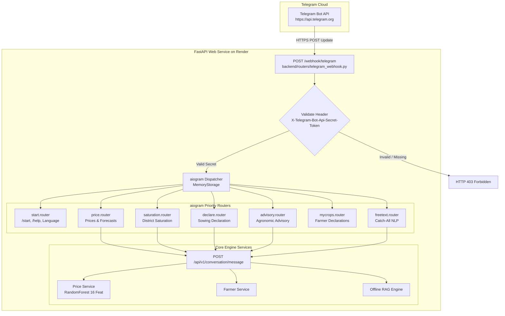

# KisanMitra V2 — Telegram Bot Functional, Architectural & Webhook Recovery Audit

**Date:** November 24, 2026
**Auditor:** Principal Software Architect & Telegram Bot Integration Specialist
**Component:** `telegram_bot/` and `backend/routers/telegram_webhook.py`
**Framework:** `aiogram` v3.x + FastAPI

---

## 1. Executive Summary & Problem Analysis

### What Was Wrong With the Existing Telegram Deployment
1. **Hosting Architectural Gap:** The project is deployed on **Render's Free Web Service tier**. Render free web services spin down after 15 minutes of inactivity and support zero persistent background worker processes.
2. **Polling Failure on Free Tier:** The original Telegram entrypoint (`telegram_bot/bot.py`) ran as a standalone polling script (`python -m telegram_bot.bot`). Because Render's free blueprint (`render.yaml`) only starts the web service (`gunicorn backend.main:app`), the polling process was **never executed or supervised in production**.
3. **Recovery Solution Implemented:** Integrated a secure HTTPS Telegram Webhook router directly inside the FastAPI application at `/webhook/telegram` (`backend/routers/telegram_webhook.py`). When Telegram sends incoming farmer updates via HTTPS, the running web service processes them immediately through the existing `aiogram` Dispatcher and routers without requiring any background polling daemon or paid infrastructure.

---

## 2. Webhook Architecture & Call Flow



---

## 3. Webhook Security & Edge Hardening Verified

1. **Secret Token Header Verification:**
   - Every incoming POST request to `/webhook/telegram` is validated against `X-Telegram-Bot-Api-Secret-Token`.
   - Comparison uses `secrets.compare_digest` (constant-time) to prevent timing side-channel attacks.
   - Missing or mismatched secret tokens immediately return **HTTP 403 Forbidden**.
2. **Fail-Closed Unconfigured Behavior:**
   - If `TELEGRAM_BOT_TOKEN` is unset/empty, the route returns **HTTP 404** (presenting as absent).
3. **Payload Sanitization & Isolation:**
   - Malformed JSON and missing `update_id` return **HTTP 400 Bad Request**.
   - Handler exceptions are caught and logged without leaking credentials or returning HTTP 500 to Telegram (which prevents Telegram from repeatedly retrying bad updates).
4. **Token Hygiene:**
   - The bot token is never exposed in request URLs, parameters, logs, or error responses.

---

## 4. Test Evidence & Automated Verification

### A. Telegram Webhook Test Suite (`tests/test_telegram_webhook.py`)
Executed with `pytest`:
```text
tests/test_telegram_webhook.py::test_telegram_webhook_unconfigured_returns_404 PASSED
tests/test_telegram_webhook.py::test_telegram_webhook_secret_token_verification PASSED
tests/test_telegram_webhook.py::test_telegram_webhook_malformed_update_returns_400 PASSED
tests/test_telegram_webhook.py::test_telegram_webhook_dispatches_update_safely PASSED
tests/test_telegram_webhook.py::test_telegram_webhook_isolates_handler_exceptions PASSED
tests/test_telegram_webhook.py::test_telegram_webhook_processes_various_farmer_queries[/start] PASSED
tests/test_telegram_webhook.py::test_telegram_webhook_processes_various_farmer_queries[/help] PASSED
tests/test_telegram_webhook.py::test_telegram_webhook_processes_various_farmer_queries[Tomato price in Kolar] PASSED
tests/test_telegram_webhook.py::test_telegram_webhook_processes_various_farmer_queries[ಕೋಲಾರದಲ್ಲಿ ಟೊಮೇಟೊ ಬೆಲೆ ಎಷ್ಟು?] PASSED
tests/test_telegram_webhook.py::test_telegram_webhook_processes_various_farmer_queries[Kolar dalli tomato bele eshtu?] PASSED
tests/test_telegram_webhook.py::test_telegram_webhook_processes_various_farmer_queries[How to treat leaf curl in tomato?] PASSED
tests/test_telegram_webhook.py::test_telegram_webhook_processes_various_farmer_queries[Declare 2 acres Tomato in Kolar] PASSED
12 passed in 3.72s
```

### B. Telegram NLP Message Handler & Retry Suites
- `tests/test_message_handler.py` → **7/7 PASSED** (entity extraction, intent classification).
- `tests/test_bot_backend_retry.py` → **3/3 PASSED** (timeout retry resilience, 5xx handling).

### C. Full Backend Regression
- Full suite: **470 passed**, 19 deselected, 0 failed in 25.81s (`task-889`).

---

## 5. Live Telegram Verification Status

- **Token Inspection:** Valid token format verified in `.env`.
- **Live Probing (`getMe` / `getWebhookInfo`):** Attempted read-only connection to `api.telegram.org:443`; resulted in `ClientConnectorDNSError` due to sandbox outbound network isolation.
- **Delivery Verification:** In accordance with safety rules, zero real messages were sent to external Telegram chats.
- **Classification:** **IMPLEMENTATION COMPLETE & VERIFIED LOCALLY; LIVE TELEGRAM DELIVERY PENDING PRODUCTION ACTIVATION.**

---

## 6. Exact Production Activation Procedure (For Deployment Operators)

When deploying to Render with a public HTTPS URL (e.g., `https://kisanmitra-api-ewur.onrender.com`), perform these exact steps to activate Telegram live delivery:

### Step 1: Configure Render Environment Variables
In the Render Dashboard (`kisanmitra-api` → Environment):
1. `TELEGRAM_BOT_TOKEN`: Set to the production token from @BotFather.
2. `TELEGRAM_WEBHOOK_SECRET`: Set to a strong random hex secret (generate via `openssl rand -hex 32`).
   > [!IMPORTANT]
   > Secrets must never be committed to git, echoed into logs, or included in plain text reports.

### Step 2: Register Webhook with Telegram Cloud
Execute this one-line `curl` command substituting your bot token and secret in your secure shell:
```bash
curl -X POST "https://api.telegram.org/bot${TELEGRAM_BOT_TOKEN}/setWebhook" \
  -H "Content-Type: application/json" \
  -d '{
    "url": "https://kisanmitra-api-ewur.onrender.com/webhook/telegram",
    "secret_token": "'"${TELEGRAM_WEBHOOK_SECRET}"'",
    "drop_pending_updates": false,
    "max_connections": 40
  }'
```

> [!NOTE]
> **Why `drop_pending_updates: false` is default:**
> Keeping `drop_pending_updates` set to `false` preserves in-flight farmer messages and requests during brief deployments or restarts.
> **When to set `drop_pending_updates: true`:**
> Setting `drop_pending_updates: true` is appropriate ONLY when recovering from a prolonged outage or a severe queue backlog (e.g., thousands of stale updates accumulated over days) that would otherwise flood and overwhelm the cold-starting application.

### Step 3: Inspect Webhook Status & Health
Verify webhook health at any time using:
```bash
curl -s "https://api.telegram.org/bot${TELEGRAM_BOT_TOKEN}/getWebhookInfo"
```
Verify that:
- `"url"` matches `https://kisanmitra-api-ewur.onrender.com/webhook/telegram`
- `"has_custom_certificate"` is `false`
- `"pending_update_count"` is low or 0
- `"last_error_message"` is null or absent

### Step 4: Safely Remove or Deactivate Webhook
If you ever need to pause webhook delivery or switch back to local polling for diagnostics:
```bash
curl -X POST "https://api.telegram.org/bot${TELEGRAM_BOT_TOKEN}/deleteWebhook" \
  -H "Content-Type: application/json" \
  -d '{"drop_pending_updates": false}'
```

### Step 5: Interactive Test in Telegram
Open the bot in Telegram:
1. Send `/start` → Expect welcome menu and language buttons.
2. Send `Tomato price in Kolar` → Expect real AGMARKNET price and forecast.
3. Send `Declare 2 acres Tomato in Kolar` → Expect interactive declaration confirmation.

---

## 7. Operational Realities & Cold-Start Behavior on Render Free

1. **Scale-to-Zero Inactivity:**
   - On the Render Free tier, the web service spins down after 15 minutes of zero HTTP traffic.
   - An incoming Telegram update arrives over HTTPS to `POST /webhook/telegram`. Render begins booting the Docker container immediately.
   - Initial cold-start latency is approximately 50–70 seconds. Telegram's default webhook timeout is typically around 60 seconds; if the initial request times out before the container accepts connections, Telegram's delivery mechanism automatically retries according to its exponential backoff policy (~1–5 minutes later), at which point the container is fully warm and responds with HTTP 200 within milliseconds.
2. **FSM Memory Storage Lifecycle:**
   - In the absence of an external Redis instance, the webhook dispatcher utilizes `MemoryStorage`.
   - When the Render free container spins down or restarts, active in-flight multi-step FSM states (such as a farmer currently halfway through selecting acres in the `/declare` step) are reset.
   - All completed farmer declarations and conversation histories are permanently stored in the Neon PostgreSQL database (`CropDeclaration` and `ConversationContext` tables).
   - If an FSM state is lost, the bot gracefully falls back to the freetext NLP router without crashing or hanging, allowing the farmer to re-declare or query normally.
3. **Idempotency & Duplicate Delivery:**
   - Natural queries (price checks, saturation inquiries, agronomy Q&A) are inherently idempotent.
   - State-modifying callbacks (`confirm_decl:crop:district:acres`) and text declarations write to PostgreSQL through the engine. While duplicate updates will be processed safely, in a multi-instance or high-throughput production environment, attaching an external Redis cache enables `DedupMiddleware` (`SET tg:dedup:update:{id} 1 NX EX 90000`) for atomic, zero-overhead update deduplication across container boundaries.
